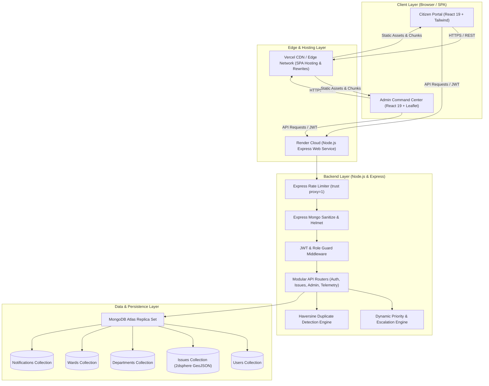

# Fix My Ward — Complete Technical Study Guide & Architectural Reference

---

## 1. Executive Summary

**Fix My Ward** is an enterprise-grade, cloud-native Civic Grievance Redressal and Ward Infrastructure Management platform. It bridges municipal administration and citizens by providing a transparent, verifiable channel for reporting, monitoring, and resolving civic defects (e.g., road potholes, water leakages, garbage overflows, electrical hazards, and public health concerns).

### Core Capabilities
* **Citizen Portal**: Geospatial issue submission with coordinate detection, automatic client-side duplicate warning, community upvoting, and lifecycle tracking.
* **Municipal Live Command Center**: Real-time GIS monitoring with priority-colored pins, emergency alerts, dynamic filtering, and interactive ward boundaries.
* **Administrative Operations Suite**: Departmental assignment, resolution tracking, SLA monitoring, operational audit trails, analytics, and citizen directory.

---

## 2. High-Level System Architecture



---

## 3. Technology Stack Breakdown

| Layer | Technology | Version | Purpose |
| :--- | :--- | :--- | :--- |
| **Frontend Framework** | React | 19.2.5 | Component-driven UI rendering with concurrent hooks |
| **Build & Dev Tool** | Vite | 8.0.10 | ESM bundling, fast HMR, asset code-splitting |
| **Routing** | React Router DOM | 7.14.2 | Client-side routing, protected routes, nested admin layouts |
| **Styling & Design System** | Tailwind CSS | 3.4.4 | Utility-first CSS, custom GovTech slate/emerald palette |
| **Typography** | Google Fonts | Web | `Plus Jakarta Sans` (Display/Headings), `Inter` (Body/Data) |
| **GIS & Mapping** | Leaflet & React-Leaflet | 1.9.4 / 5.0.0 | Client-side GIS map rendering, interactive coordinate selection |
| **Data Visualization** | Recharts | 3.9.2 | Administrative resolution trends, department distribution charts |
| **HTTP Client** | Axios | 1.15.2 | Asynchronous REST requests with JWT Authorization headers |
| **Backend Runtime** | Node.js | >= 20.x | Non-blocking, event-driven JavaScript server runtime |
| **Web Server Framework** | Express.js | 4.19.2 | REST API design, middleware pipelines, routing |
| **Database** | MongoDB & Mongoose | 8.3.1 | Document database, 2dsphere GeoJSON spatial queries |
| **Authentication** | JSON Web Tokens & bcryptjs | 9.0.2 / 2.4.3 | Stateless JWT tokens, PBKDF2/bcrypt salted password hashing |
| **Security Middleware** | Helmet & express-mongo-sanitize | 7.1.0 / 2.2.0 | Security headers (CSP, X-Frame) and NoSQL injection sanitizer |
| **Frontend Hosting** | Vercel | Production | Global CDN, SPA rewrite redirects, HTTPS edge |
| **Backend Hosting** | Render | Production | Linux container hosting, automatic Git triggers, zero-downtime |

---

## 4. Database Architecture & Data Modeling

### 4.1. Issue Model (`backend/models/Issue.js`)
The `Issue` entity represents civic grievances reported by citizens. It utilizes a GeoJSON `Point` geometry for geospatial indexes.

```javascript
{
  title: { type: String, required: true, trim: true },
  description: { type: String, required: true },
  category: { 
    type: String, 
    enum: ["Road", "Water", "Garbage", "Electricity", "Surroundings", "Other"],
    required: true 
  },
  locationText: { type: String },
  location: {
    type: { type: String, enum: ["Point"], default: "Point" },
    coordinates: { 
      type: [Number], // Stored as [longitude, latitude] per GeoJSON specification
      required: true 
    }
  },
  images: [{ type: String }],
  status: {
    type: String,
    enum: ["Pending", "Verified", "Assigned", "In Progress", "Resolved", "Rejected"],
    default: "Pending"
  },
  priority: {
    type: String,
    enum: ["Low", "Medium", "High", "Critical"],
    default: "Low"
  },
  department: { type: String, default: "" },
  assignedOfficer: { type: String, default: "" },
  verified: { type: Boolean, default: false },
  upvotes: [{ type: mongoose.Schema.Types.ObjectId, ref: "User" }],
  reportedBy: { type: mongoose.Schema.Types.ObjectId, ref: "User", required: true },
  createdAt: { type: Date },
  updatedAt: { type: Date }
}
```

#### Performance Indexes
```javascript
issueSchema.index({ location: "2dsphere" }); // Enables $near proximity queries
issueSchema.index({ status: 1 });
issueSchema.index({ priority: 1 });
issueSchema.index({ category: 1 });
issueSchema.index({ department: 1 });
issueSchema.index({ createdAt: -1 });
```

---

### 4.2. User Model (`backend/models/User.js`)
Stores citizen profiles and municipal administrators.
* **Fields**: `name`, `email` (unique index), `password` (bcrypt salted hash), `role` (`citizen` or `admin`), `ward`, `phone`.
* **Password Hashing**: Pre-save hook hashes plain passwords with `bcrypt.genSalt(10)` before writing to disk.
* **Verification Method**: `matchPassword(enteredPassword)` compares candidate password with stored hash.

---

### 4.3. Department Model (`backend/models/Department.js`)
Represents the municipal operational wings (e.g., Engineering & Roads, Water Works, Sanitation, Public Lighting).
* **Fields**: `name`, `head`, `contactEmail`, `contactPhone`, `wardsCovered`, `slaHours`, `isActive`.

---

### 4.4. Ward Model (`backend/models/Ward.js`)
Represents geographic administrative wards within the municipality (e.g., Coimbatore Ward 1–100).
* **Fields**: `wardNumber`, `zone`, `councillor`, `councillorPhone`, `centerCoordinates` (`[lng, lat]`), `status`.

---

## 5. Core Algorithmic Engineering

### 5.1. Geospatial Duplicate Prevention (Haversine & GeoJSON)
To prevent duplicate reports for the same physical issue (e.g., 20 people reporting the same pothole):

1. **Client-Side Pre-Check (Haversine)**:
   When a citizen selects a map coordinate, the browser calculates great-circle distance between the selected coordinate and existing issues in the same category:
   $$\Delta\sigma = 2 \arcsin \left( \sqrt{\sin^2\left(\frac{\Delta\phi}{2}\right) + \cos(\phi_1)\cos(\phi_2)\sin^2\left(\frac{\Delta\lambda}{2}\right)} \right)$$
   $$d = R \cdot \Delta\sigma$$
   If $d < 300\text{ meters}$, an interactive modal is displayed recommending the user to upvote the existing report instead of creating a duplicate.

2. **Server-Side Proximity Guard (`$near`)**:
   ```javascript
   const nearbyIssues = await Issue.find({
     category,
     location: {
       $near: {
         $geometry: { type: "Point", coordinates: [finalLng, finalLat] },
         $maxDistance: 300, // 300 meters
       },
     },
   });
   ```

---

### 5.2. Dynamic Priority Escalation Engine (`backend/utils/calculatePriority.js`)
Priority is not static; it dynamically computes based on:
1. **Category Base Weight**: `Water` and `Electricity` have higher baseline urgency due to public hazard.
2. **Community Upvotes**:
   * $\ge 10\text{ upvotes} \implies \text{High Priority}$
   * $\ge 25\text{ upvotes} \implies \text{Critical Priority}$
3. **Aging Factor**: Unresolved issues increase in priority after passing SLA thresholds.

---

### 5.3. Autonomous Database Seeder (`backend/utils/autoSeed.js`)
On every backend server boot, `autoSeedDefaults()` executes automatically:
* Checks if `citizen@fixmyward.gov.in` exists; if missing, creates it with `password123`.
* Checks if `admin@fixmyward.gov.in` exists; if missing, creates it with `adminpassword123` and `admin` role.
* Validates and inserts default municipal departments (`Roads & Footpaths`, `Water Supply & Drainage`, `Public Health & Sanitation`, etc.) if empty.
* Guarantees zero-downtime, out-of-the-box system readiness on fresh deployments.

---

## 6. REST API Reference

### 6.1. Authentication APIs
| Method | Route | Access | Description |
| :--- | :--- | :--- | :--- |
| `POST` | `/api/auth/register` | Public | Register a new citizen account |
| `POST` | `/api/auth/login` | Public | Authenticate citizen, return JWT token |
| `GET` | `/api/auth/me` | Protected (Citizen) | Retrieve currently authenticated user profile |
| `POST` | `/api/admin/login` | Public | Authenticate municipal officer, return admin JWT |
| `GET` | `/api/admin/profile` | Protected (Admin) | Retrieve authenticated admin officer profile |

---

### 6.2. Citizen Grievance APIs
| Method | Route | Access | Description |
| :--- | :--- | :--- | :--- |
| `POST` | `/api/issues` | Protected (Citizen) | Submit civic issue with GeoJSON coordinates |
| `GET` | `/api/issues` | Public | Fetch all public issues for feed and GIS map |
| `GET` | `/api/issues/my` | Protected (Citizen) | Fetch issues reported by the logged-in citizen |
| `POST` | `/api/issues/:id/upvote`| Protected (Citizen) | Toggle community upvote on an issue |

---

### 6.3. Municipal Admin Command Suite APIs
| Method | Route | Access | Description |
| :--- | :--- | :--- | :--- |
| `GET` | `/api/admin/dashboard/kpis`| Protected (Admin) | Retrieve operational metrics (total, pending, SLA) |
| `GET` | `/api/admin/live/overview` | Protected (Admin) | Real-time live command telemetry feed |
| `GET` | `/api/admin/live/activity` | Protected (Admin) | Audit trail of latest system status transitions |
| `GET` | `/api/admin/live/issues` | Protected (Admin) | Active GIS coordinate layer with priority pins |
| `GET` | `/api/admin/live/wards` | Protected (Admin) | Ward geographic nodes and statistics |
| `GET` | `/api/admin/departments` | Protected (Admin) | List municipal departments & workloads |
| `GET` | `/api/admin/departments/:name`| Protected (Admin)| Department specific issues, staff & SLA stats |
| `GET` | `/api/admin/analytics/overview`| Protected (Admin)| High-level executive resolution statistics |
| `GET` | `/api/admin/analytics/trends` | Protected (Admin) | Daily grievance submission vs. resolution trends |
| `PATCH`| `/api/admin/issues/:id/status`| Protected (Admin)| Update grievance status, officer notes, department |

---

## 7. Frontend Engineering & Design System

### 7.1. GovTech Option 1 Design Architecture
* **Dark Slate Base**: `#0B0F19` background paired with `#131B2E` frosted glass card surfaces.
* **Civic Emerald Accents**: `#10B981` (active badges, CTA buttons, focus states, success notifications).
* **Typography Hierarchy**:
  * Headings, Hero titles & Labels: `Plus Jakarta Sans` (weights 600, 700, 800).
  * Body, Telemetry counters & Tables: `Inter` (weights 400, 500, 600).
* **Day Theme (Light Mode) Contrast Rule**:
  * Strict `#0F172A` deep navy/black text on white `#FFFFFF` / `#F8FAFC` background.
  * Form labels set to bold (`font-weight: 700`) with high-contrast `#94A3B8` borders to eliminate washed-out grey text.

---

### 7.2. Zero-API-Key Leaflet GIS Map Layer
* Standard OpenStreetMap tiles (`https://{s}.tile.openstreetmap.org/{z}/{x}/{y}.png`) are utilized without relying on third-party API keys (e.g. Mapbox, CartoDB).
* In Dark Mode, a CSS invert/contrast filter is applied directly to `.dark .leaflet-tile-pane`:
  ```css
  html.dark .leaflet-tile-pane,
  .dark .leaflet-tile-pane {
    filter: brightness(0.65) invert(1) contrast(3) hue-rotate(200deg) saturate(0.3) brightness(0.75);
  }
  ```
* Generates a sleek, high-tech dark map aesthetic with zero API quotas or watermarks.

---

## 8. Security & Production Hardening

1. **Reverse Proxy Trust**:
   Render sits behind Cloudflare reverse proxies. `app.set("trust proxy", 1);` is configured in `server.js` to ensure client IP addresses are accurately resolved and `express-rate-limit` does not reject valid requests with `ERR_ERL_UNEXPECTED_X_FORWARDED_FOR`.
2. **Rate Limiting**:
   * Auth endpoints (`/api/auth/login`, `/api/admin/login`): 50 requests per 15-minute window.
   * General API endpoints: 300 requests per 15-minute window.
3. **NoSQL Injection Sanitization**:
   `express-mongo-sanitize` strips any request payload containing `$` or `.`, neutralizing NoSQL operator injections.
4. **Content Security Policy & Headers**:
   `helmet()` applies strict HTTP headers (`X-Content-Type-Options`, `X-Frame-Options: SAMEORIGIN`, `Strict-Transport-Security`).
5. **SPA Direct URL Rewrites**:
   `frontend/vercel.json` provides an explicit routing rewrite:
   ```json
   {
     "rewrites": [
       { "source": "/(.*)", "destination": "/" }
     ]
   }
   ```
   Prevents Vercel 404 errors on browser page reload across client-side routes (`/dashboard`, `/report`, `/admin/*`).

---

## 9. Developer Onboarding & Local Setup

### Prerequisites
* **Node.js**: v20.x or v22.x
* **MongoDB**: Local instance running on port 27017 or a MongoDB Atlas URI
* **Git**: Version control

### Installation & Run

1. **Clone the repository**:
   ```bash
   git clone https://github.com/SURYA00714/fix-my-ward.git
   cd fix-my-ward
   ```

2. **Configure Backend**:
   ```bash
   cd backend
   npm install
   # Create .env file
   cat <<EOF > .env
   PORT=5000
   MONGO_URI=mongodb+srv://<username>:<password>@cluster.mongodb.net/fixmyward
   JWT_SECRET=your_super_secret_jwt_key
   NODE_ENV=development
   EOF
   npm run dev
   ```

3. **Configure Frontend**:
   ```bash
   cd ../frontend
   npm install
   # Create .env file
   cat <<EOF > .env
   VITE_API_URL=http://localhost:5000
   EOF
   npm run dev
   ```

4. **Default Logins**:
   * **Citizen**: `citizen@fixmyward.gov.in` / `password123`
   * **Admin**: `admin@fixmyward.gov.in` / `adminpassword123`

---

## 10. Viva / Technical Review Questions & Model Answers

### Q1: Why did you use GeoJSON `Point` coordinates stored as `[longitude, latitude]` instead of `[latitude, longitude]`?
> **Answer**: MongoDB implements the international **GeoJSON standard (RFC 7946)**, which adheres to Cartesian coordinate ordering $(X, Y)$ where $X$ corresponds to Longitude (East/West) and $Y$ corresponds to Latitude (North/South). Storing them in `[lng, lat]` format is mandatory for MongoDB's `2dsphere` index to calculate geodesic distances and perform `$near` queries accurately.

### Q2: How does the application prevent duplicate issue submissions?
> **Answer**: The application employs a two-tier defense:
> 1. **Client-side**: When an issue is drafted, the frontend calculates the Haversine distance against fetched issues in the same category. If a duplicate exists within 300 meters, a modal prompts the user to upvote the existing issue instead.
> 2. **Server-side**: The backend queries the `2dsphere` index using `$near` with `$maxDistance: 300`. If `forceSubmit` is not flagged, it flags the nearby records to ensure municipal departments are not inundated with duplicate tickets.

### Q3: Why is Express `trust proxy` required when deploying to Render or Vercel?
> **Answer**: Cloud hosting platforms route incoming client traffic through reverse proxies and load balancers. These proxies attach the client's real IP address into the `X-Forwarded-For` HTTP header. If Express does not have `app.set("trust proxy", 1)` enabled, `express-rate-limit` detects an un-trusted header and throws a security validation error (`ERR_ERL_UNEXPECTED_X_FORWARDED_FOR`) to prevent IP spoofing attacks.

### Q4: How is responsive theming (Dark & Day Mode) implemented without visual wash-out?
> **Answer**: The system pairs Tailwind CSS's `.dark` class with high-specificity global CSS overrides in `index.css`. In Light (Day) theme, text colors are forced to `#0F172A` (deep dark slate), borders are hardened to `#94A3B8`, and form labels are rendered at `font-weight: 700`, preventing the washed-out grey readability issue often seen in default templates. Leaflet tiles use CSS filters in dark mode so the map matches the UI without requiring commercial map provider API keys.
